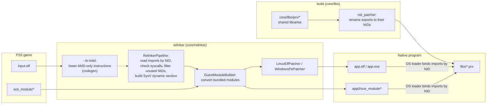
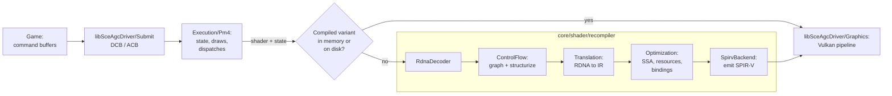
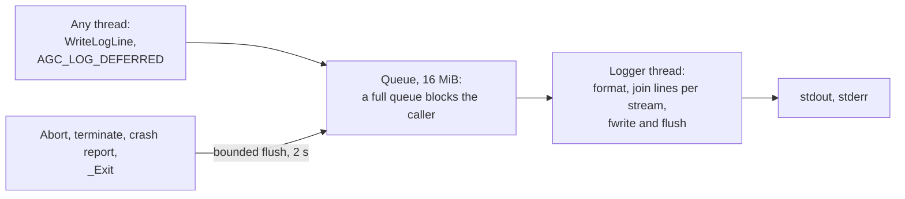

# Architecture

How a PS5 executable becomes a native Linux or Windows program. Nothing is emulated: the converted executable runs as a normal process and calls native implementations of the system libraries.

## Overview

- [`core/relinker/main.cpp`](../../core/relinker/main.cpp) runs the steps in this order. `--to-intel` is optional, see [USAGE.md](../user/USAGE.md).
- Each library in [`core/libs/prx`](../../core/libs/prx) builds as a shared library. After the build, `nid_patcher` ([`core/libs/nid`](../../core/libs/nid)) renames every export to its NID, computed from the function name. `APS5_EXPORT("<nid>", func)` sets the NID directly when the name is unknown. Every other library keeps the names libc exports; it reads them from `libc.exports`, which `nid_patcher --write-export-list` rewrites only when that list changes. On Windows the link writes each import library with `SOURCE_DATE_EPOCH=0` and `ranlib -D` and replaces it only when its bytes change. A source edit that keeps the exports therefore relinks and re-patches only its own library.

## Main-module entry registers

The host stubs that transfer control to the guest `e_entry` are not the same on every platform, and the console's register contract at that point is not measured here (#9048). What the stubs establish today:

| Host | Source | `rdi` | `rsi` | `rdx` | `rbp` | Return from entry |
|---|---|---|---|---|---|---|
| Linux | [`EntryStubBuilder.cpp`](../../core/relinker/elfpatcher/src/general/EntryStubBuilder.cpp) | process stack: qword `argc`, then argv pointers, then a null | 0 | left as the host dynamic linker left it (often `rtld_fini`) | zero frame `{0, 0}` | `ud2` |
| Windows | [`WindowsEntryStubBuilder.cpp`](../../core/relinker/elfpatcher/src/windows/WindowsEntryStubBuilder.cpp) | `VirtualAlloc` block: qword `argc`, UTF-8 argv pointers, null | address of an exit trampoline that finalizes guest modules and returns | not set by the stub (last host call is `FreeLibrary`) | zero frame in the stub's stack | `ExitProcess` with the entry's return code |
| macOS | [`MacOsImage.cpp`](../../core/relinker/elfpatcher/src/macos/MacOsImage.cpp) | guest entry address into `_Aps5StartGuest_nid_no_patch` | stack block `{argc, argv…, 0, envp…, 0}` | — | — | `Aps5StartGuest` has no implementation on `main`, so the final guest-entry registers are unset |

On Linux the argument block is the process stack itself (`mov rdi, rsp`). On Windows it is a separate allocation the stub fills with UTF-8 argument strings. Titles that read only `argc`/`argv` through `rdi` see the same layout shape on both; titles that call through `rsi` on Windows get a host exit path that Linux does not provide (`rsi` is zero there).

## Game patches

[`GamePatch.cpp`](../../core/relinker/relinker/src/patching/GamePatch.cpp) parses the patch file, a strict subset of TOML. `Conversion::Convert` applies the entries of its own target to the executable bytes right after reading them, and to each bundled module before `GuestModuleBuilder` reads it, so every later stage sees patched bytes. Entry virtual addresses are translated through the `PT_LOAD` segments, and a range may not touch the ELF header or program header table, which the output writers rewrite. The patched file ranges are then checked against every in-place writer: the `--to-intel` reports and trampoline sites, `RelinkPatch` records and syscall trap ranges. The patched virtual address ranges are checked against the 8-byte targets of the `RelaData` and `RelaPltData` relocations, which the loader or the output writers overwrite. `main.cpp` builds the manifest text before it writes any output. `main.cpp` matches targets after the conversions, aggregates the applied records into `<output-stem>.patches.toml`, and runs `--verify-patches` through `GamePatch::VerifyPatches`, which reads only bytes.

## Windows deferred module initialization

Runtime-loaded Windows modules export `__aps5_guest_initialize`: the entry RVA, the initializer count and the RVAs of initializer pointer slots. [DynamicLoader.cpp](../../core/libs/prx/libkernel/Module/src/DynamicLoader.cpp) consumes the first two words in the mapped image after initialization, so another reference to that image does not run it again. Unloading the image discards this state; a later load reads the original table from the file, including when Windows reuses the same base address. Native references outside the guest handle table retain the same initialized image.

While initialization runs, the count is `UINT32_MAX` and the entry word holds the initializing Windows thread ID. A different thread waits on the loader's condition variable; the owning thread can recursively open its module. Completion clears both words, restores the table's original page protection and wakes waiters. An exception leaves the count at `UINT32_MAX` with thread ID 0, so another load rejects that image until it is unloaded. The table's file format is unchanged and its initializer slots remain intact.

[GuestDeferredModule.cpp](../../core/libs/tests/GuestDeferredModule.cpp) checks repeated loads at the same base, multiple guest references, an external native reference, concurrent initialization and recursive loading. The Windows fixture uses the same table layout as the relinker and reports its entry and constructor calls separately.

## Windows allocator

On Windows, a relinked game run with `APS5_MIMALLOC` set (to any value) allocates through [mimalloc](../../3rdparty/mimalloc) instead of the C runtime's heap: its libraries and the C and C++ runtime they use. Without the variable the game keeps the C runtime's heap.

- The build copies `mimalloc.dll` and `mimalloc-redirect.dll` beside the libraries ([`core/libs/CMakeLists.txt`](../../core/libs/CMakeLists.txt)). [`pe_import_first`](../../core/libs/allocator/PeImportFirst.cpp) moves `mimalloc-redirect.dll` to the front of the copied `mimalloc.dll`'s import directory. The redirection module has to load before mimalloc, and MinGW's linker does not keep that order.
- When `APS5_MIMALLOC` is set, the relinker's Windows entry stub ([`WindowsEntryStubBuilder.cpp`](../../core/relinker/elfpatcher/src/windows/WindowsEntryStubBuilder.cpp)) loads `mimalloc.dll` from the run path with `LoadLibraryExW` before the first library. `mimalloc-redirect.dll` then sends the C runtime's allocation functions in `ucrtbase.dll` (`malloc`, `calloc`, `realloc`, `free` and their relatives) to mimalloc for the whole process. The libraries loaded after it, and the MinGW runtime DLLs they use (`libstdc++`, `libgcc_s`, `libwinpthread`), allocate and free through mimalloc.
  - Without `mimalloc.dll` the load fails quietly and the process keeps the C runtime's heap. With a relative run path, a module directory too long for the stub's path buffer skips the load the same way.
  - A run path whose `mimalloc.dll` path cannot fit that buffer fails the relink, as a library path does.
- Guest code, the executable and its bundled modules, allocates through libc's guest heap ([`GuestHeap.cpp`](../../core/libs/prx/libc/src/GuestHeap.cpp)). The guest heap takes its blocks from the guest arena, or from `malloc` when there is no arena, and returns them the same way, so a block never moves between the guest heap and the host allocator.
- `mimalloc.dll` links the MinGW runtime statically, and three parts of it allocate through the C runtime: GCC's emulated thread-locals (`emutls`, which hold mimalloc's own thread-locals), MinGW's thread-exit destructor list and winpthreads.
  - After the redirection these calls would enter mimalloc again, before the calling thread's mimalloc state exists.
  - Linker wraps send them to [`RuntimeHeap.c`](../../core/libs/allocator/RuntimeHeap.c), which allocates from the process heap (`HeapAlloc` on `GetProcessHeap()`). The same code frees these blocks through the same wraps.

## Thread cancellation

[`Thread.cpp`](../../core/libs/prx/libkernel/Pthread/src/Thread.cpp) records cancellation requests on the target guest thread. New threads start with cancellation enabled and deferred. A disabled request stays pending; enabling deferred cancellation returns before the next cancellation point acts on it. Repeated requests do not add cleanup invocations.

[`Cancel.hpp`](../../core/libs/prx/libkernel/Pthread/include/Cancel.hpp) connects condition, semaphore and join waits to the request. A canceled condition waiter reacquires its guest mutex before cleanup. Semaphore and join waits release their internal locks before exiting. A request pending on entry to a semaphore wait is acted on before consuming an available token; a canceled join leaves its target joinable and its result output untouched.

Cancellation exits through `scePthreadExit` with result pointer `1`. It runs cleanup handlers in reverse push order before thread-specific destructors; cancellation points inside cleanup must not start another exit. The host thread then terminates through the existing Windows or Linux lifecycle, and join waits for that termination. Host thread termination is not used to inject cancellation into a running guest frame.

The reference contract and constants come from FreeBSD libthr, pinned at [`5ed7eb0d`](https://github.com/freebsd/freebsd-src/blob/5ed7eb0d97ba4436218e810f61bd059acba984c2/lib/libthr/thread/thr_cancel.c), with cleanup and exit ordering in [`thr_exit.c`](https://github.com/freebsd/freebsd-src/blob/5ed7eb0d97ba4436218e810f61bd059acba984c2/lib/libthr/thread/thr_exit.c#L196-L259). These are reference semantics, not console measurements. The supported cancellation points and incomplete asynchronous behavior are listed in [TechnicalDebt](TechnicalDebt.md).

[`GuestPthreadCancelRecovery.cpp`](../../core/libs/tests/GuestPthreadCancelRecovery.cpp) checks pending requests before ordinary and timed semaphore acquisition, cleanup reentrancy and destructor ordering, enabled and disabled timed condition waits, canceled join output, and subsequent resource and thread reuse. Host atomic gates establish pending requests; acquiring the condition mutex after the worker releases it establishes wait entry without a scheduling sleep. Both `guest_pthread_cancel_recovery` and `guest_pthread_cancel_recovery_coarse` retain checks in Release and have a 20-second timeout, shorter than the 60-second guest waits. The latter sets `APS5_COARSE_TIMED_WAITS=1` to exercise the Windows fallback; Linux uses that condition-variable path by default.

## APR and AMM command buffers

[`Apr.cpp`](../../core/libs/prx/libkernel/Apr/src/Apr.cpp) executes APR and AMM command buffers. A buffer runs on the submitting thread until a `WaitOnAddress` or `WaitOnCounter` that is not yet satisfied; the rest of it, and every buffer submitted after it, is copied and runs on a worker thread, so a submitter that satisfies the wait after the submit returns does not hang. Buffers without such a wait still complete before the submit returns.

APR and AMM each have their own queue and worker thread. Order is kept inside a queue; a wait in one does not hold up the other, because AMM `WriteAddress` commands advance the counters that APR buffers wait on. Submission ids are per queue, and `sceKernelAprWaitCommandBuffer` and `sceAmprAmmWaitCommandBufferCompletion` block until the queue has completed that id. A command that throws on a worker aborts the process.

[`GuestAmpr.cpp`](../../core/libs/tests/GuestAmpr.cpp) checks both cases: a submit whose wait is satisfied afterwards returns and keeps buffer order, and an AMM buffer submitted after a waiting APR buffer still completes.

## Graphics

- [`Recompiler.cpp`](../../core/shader/recompiler/Recompiler.cpp) runs the stages in this order. With `ANYPS5_ENABLE_SPIRV_TOOLS`, the SPIR-V is also validated and optimized with SPIRV-Tools.
- With SPIRV-Tools enabled, recompiler input and optimizer output are fully validated before specialization scanners run. After descriptor compaction, the compact module is fully validated when its words differ from the already validated materialized module; byte-identical compaction reuses that validation, without skipping validation of the new optimizer output.
- `ShaderRecompiler::Recompile` keeps compiled variants in memory, and `ShaderDiskCache` stores them on disk so later runs reuse them. Before the writable cache, a miss is also looked up in read-only prebuilt packs and loose entry folders under `shader_cache/prebuilt`; pack entries are ordinary encoded cache entries behind a sorted key-hash index, validated by magic, compiler source version and index checksum when mapped, and a miss or rejected entry falls through to the writable cache and the compiler. Cache format 35 also stores the finite stencil-reference set, its replay-safety proof and reserved push-data word in the artifact and binding layouts. Entries from formats 31 to 34 are rejected.
- The Vulkan pipelines are journaled as well ([`PipelineJournal.cpp`](../../core/libs/prx/libSceAgcDriver/Graphics/src/PipelineJournal.cpp)): a graphics pipeline the store builds (`CachedPipeline`) or a compute pipeline a dispatch builds is appended to `pipelines.journal` next to the shader cache entries, as the materialized result of each stage (the specialized SPIR-V, bindings and push constants, through `ShaderDiskCache::EncodeResult`) plus the recipe the pipeline was built from (`GraphicsPipelineRecipe`: the stages' identities, vertex input layout, descriptor set layout keys and the state fields the `Pipeline` constructor reads, `CanonicalPipelineState`). When a `VulkanDevice` is created, the journal is loaded and its pipelines are built on a pool of `hardware_concurrency() / 2` threads (`APS5_PIPELINE_JOURNAL_THREADS`) while the title loads, so the first draw or dispatch of a configuration seen on an earlier run finds its pipeline resident. The pipeline stores key on `RecompileResult::Identity`, a hash of the module words, specialization constants, subgroup width and bindings that is the same on every run (`SharedSpirv::ContentHash`, computed once per shared module), rather than on the process-lifetime variant ids, and a graphics pipeline is built outside the store's mutex, so the replay threads and the queue workers build in parallel. A draw that arrives before its replayed entry builds the pipeline itself; the first inserted wins. A replayed entry enters the store at its least recently used end and a full store takes none, so the title's own pipelines are never evicted for a replayed one, and the optimized relink of a replayed pipeline (`OptimizedPipeline::Schedule`) waits for the first draw that binds it, so the relink thread serves the title's pipelines first. A device created without a window starts its replay at its first draw or dispatch rather than at creation, since `Driver::AttachWindow` usually replaces it before the title draws. The journal records a pipeline once (modules and recipes are deduplicated by content), keeps at most `APS5_PIPELINE_JOURNAL_MAX_MIB` (1024), replays the first `APS5_PIPELINE_JOURNAL_ENTRIES` recorded (1024, the pipeline store's bound, `APS5_PIPELINE_STORE_ENTRIES`; a run reaches those first), and is disabled with `APS5_NO_PIPELINE_JOURNAL=1` or without a shader cache directory. The file header names the device (`PipelineJournalDeviceFingerprint`, the properties the driver's pipeline cache file is named by), so a journal written for another GPU or driver is started over rather than replayed; appends and reads hold `pipelines.journal.lock` against another process sharing the directory, and a device cancels its replay before it is replaced (`PrepareForReplacement`) or destroyed, so a replaced headless device never inserts entries the window's device then sweeps. `APS5_PROFILE_DRAW=1` prints a `[pipeline-journal]` summary when the replay finishes and at teardown.
- A compute shader whose LDS plus its lock dword exceeds the host's `maxComputeSharedMemorySize` is not given a `Workgroup` array. `Recompile` sets `ShaderInfo::sharedMemoryBytes` for it and the SPIR-V backend addresses the LDS in a coherent storage buffer at descriptor set 1 (`WorkgroupMemoryDescriptorSet`), with a slice of `RecompileResult::workgroupMemoryDwords` per workgroup, indexed by `WorkgroupID` and `NumWorkGroups`. `VulkanDevice` keeps one such buffer, sized from the dispatch dimensions, and binds it after the resource set; programs that fit keep using shared memory.
- `Driver::RegisterShader` splits shader preparation in two. `PlanRegistered` runs on the registering guest thread: it validates the registers and entry point, decodes the code and builds the recompile request, so invalid registrations still fail there. The RDNA to IR translation and resource plan (`PrepareShader`) run on a background pool of `hardware_concurrency() / 2` detached threads (at least 2, 64 MiB stacks).
- A thread that needs the GPU mutex, the committer's next item or the end of the committer's queue spins before it blocks (`HandoffSpin.hpp`): `GpuMutexType::lock` retries `try_lock` for the window, the committer polls its item count, and `DrawPipeline::Drain` polls it for twice the window, so a hand-off that completes within the window costs no kernel wake-up. The window is 150 us when the process may run on more than 8 logical processors (its affinity mask, via `CpuTopology`) and 0 otherwise, where the spinning threads would compete with the holder; `APS5_HANDOFF_SPIN_US=<n>` sets it (0 turns it off, at most 10000). Ordering and the lock's semantics are unchanged.
- Queue 0's packet worker decodes, captures and prepares a draw and hands its recording (`Graphics::Draw` under the GPU lock) to a committer thread in [`DrawPipeline.cpp`](../../core/libs/prx/libSceAgcDriver/Execution/src/Driver/Draw/DrawPipeline.cpp), so the next packet is decoded while the previous draw is recorded. Each queued item carries the guest ranges it will write (`DrawWriteRanges`: written buffers and storage images, color targets with their DCC and CMASK, depth and stencil). A later packet that reads or writes one of those ranges, or that the pipeline can't order, drains it first; labels, submission ends, buffer fills and (with `APS5_PIPELINE_DMA=1`) DMA packets are queued as items instead. With `APS5_PIPELINE_DISPATCH=1` (off by default), a `DISPATCH_DIRECT` whose dispatch-cache entry hits with a recipe is queued as an item too, carrying the dispatch's written buffers and storage images (`DispatchWriteRanges`); the capture and the cache lookup stay on the worker and the recipe is recorded on the committer. A dispatch still drains when its lookup misses, when what it reads overlaps a write still pending, when the hit is verified against data or when its writes cannot be ranged (bindless access, GDS, fault buffer). An indirect draw resolved on the CPU (its records read by the worker) drains only when its records or its count overlap a queued write; the records it draws inline drain first, and its last drawn record is queued like a direct draw (`APS5_NO_PIPELINED_INDIRECT=1` drains at every indirect draw). An exception thrown by a commit is rethrown on the worker at its next enqueue or drain, as an inline draw error would be. On by default; `APS5_PIPELINED_DRAWS=0` records every draw inline, and `APS5_EXACT_DRAW_WRITES=0` widens the color and depth ranges to estimates.
- A dispatch's resource build runs stage A (binding plan, buffers, descriptor set) without the GPU lock and stage B (image lookups) under it. Between them `VulkanDevice::presync` waits, still without the lock, for recorded work that writes a surface stage B would read on the CPU and for recorded work that writes the DCC keys of an image the dispatch binds (`ShaderResources::PresyncSurfaces`), so the locked `WaitForKeyWriters` finds nothing pending to synchronize with. A key range is waited for only when recorded work writes it, the key-store memo does not give its value (`DccKeyWritersPending`, without the mutex) and the pending stores do not give it either (`DccKeyWriterNeedsSync`, under the mutex, the same test `WaitForKeyWriters` makes before it synchronizes). Stage A's own key scan runs before that wait, and stage B compares it with the keys it reads under the lock as before. `APS5_NO_DCC_PRESYNC=1` leaves the key ranges out; `APS5_NO_PRESYNC=1` disables the whole pre-sync.
- `APS5_DRAW_PIPELINE=1` (off by default, meant with `APS5_PIPELINED_DRAWS=32 APS5_PIPELINE_DISPATCH=1`) takes more of a draw off the worker. A `DrawFinisher` thread runs the second half of a direct pipelined draw (stage materialization, the draw cache insert and the hand-off to the committer) while the worker reads the next packets; the worker drains it before the next draw's cache lookup, before packets other than register writes and draws, and before guest reads, and finishes in place a draw whose stages may write memory (`ProgramWritesMemory`) or write through the BDA page table. The committer skips the fragment-output validation and storage-image layer scans whose inputs match its last commit (`CommitTrims`), and a resource or storage image proved current keeps its proof for the rest of the collect epoch until `GuestMemory::BreakProofs` (a CPU write, a write-back, a recorded write) moves `ProofSerial`. Color metadata passes go through the pipeline with their write ranges (`PipelinedColorMetadataPassWrites`) instead of draining it. A data-only hit whose shape entry belongs to an older draw replaces that entry in place at the second sight of the same read user words. On Linux the main image's pages get a page table entry, and capture pages are pooled across threads. `APS5_VERIFY_DRAW_PIPELINE=1` runs a full check next to 1 in 64 reused proofs and prints `[epoch-proofs]` counts.
- The shader registry maps a code address to every header registered for that code, in registration order. Static, graphics and rectangle ABI resolution pick the header at the bound address (or one equal to it, `SameHeader`, which also takes a hull header fused by `sceAgcFuseShaderHalves` (type 3) as the registered back half (type 7) it copies, the fused registers aside; graphics ABI resolution then uses the fused header's shader registers); draws and dispatches pick the program by the stage's binary type (`RegisteredProgram`), and a front entry matching both type 2 and type 4 throws. Within a type the last registration wins; re-registering an identical earlier header makes its snapshot current again without preparing it again, and changed code drops the older headers.
- The snapshot is published as pending. `SourceHandleFor`, `InvocationFor` and `ShaderPreparationTransaction::Edit` / `Read` wait for the pending job before reading `PreparedShaders`, and rethrow its failure. `APS5_SYNC_SHADER_PREPARE=1` prepares on the registering thread instead.
- `APS5_LAZY_SHADER_PREPARE=1` retains registration validation and decoding but discards the temporary plan without queueing preparation. The snapshot is deferred, not pending; draws and dispatches prepare and cache it on first use. A compute or pixel stage's explicit ABI resolution (`ResolveShaderAbi`) plans the stage with the ABI's state, records the ABI and leaves its preparation to the shader's first use, which prepares it with that state (`PreparedShaders::deferredAbis`), so a shader that never draws or dispatches stays unprepared; a graphics-stage ABI is still prepared when it is resolved. This opt-in mode takes precedence over synchronous registration preparation and trades background CPU/memory use for possible first-use stalls; disk caches and shader output are unchanged.
- On devices with graphics pipeline libraries (`SpirvTarget::registrationModules`), a vertex or pixel artifact is emitted in registration form: the buffer V# words, image modes, swizzles and mip ranges, depth-compare state, export mappings and vertex component selectors it used to specialize on per draw are read at run time (image `ResourceMetadata` and a few state dwords in the shader data), descriptor heaps keep every element in place (an unused one gets a null or placeholder descriptor), and the pixel stage's bindings live in descriptor set 1 so each stage's library depends only on its own set layout (`INDEPENDENT_SETS`). An artifact above `registrationWordLimit` SPIR-V words is re-emitted specialized, and `CompiledShaderArtifact::registrationModule` records which form it has. For artifacts in registration form, `RegistrationResult` materializes the module once, and `PrebuildStageLibrary` builds its pre-rasterization or fragment-shader library on a separate one-thread pool (`APS5_PREBUILD_THREADS`) with a fixed default state, pairing it with a stub stage. A later draw with that state finds both libraries in the store and only links.
- A draw or dispatch whose state matches no artifact prepared at registration (a title that builds its static ABI state itself, without `sceAgcDriverResolve*Abi`) gets one prepared at use by `SourceHandleFor` or `InvocationFor`, logged once per artifact and kept in the snapshot for the next use.
- A stage that `sceAgcDriverResolve*Abi` cannot prepare for the state the title creates its pipeline with (a compute shader that calls user-data pointers, a descriptor the resource plan rejects) is left to its first use like a stage deferred at registration: `ResolveShaderAbi` and `PrepareGraphicsStages` catch the failure inside their own preparation transaction, so the `ShaderPreparationScope` the title's call runs in still commits, log it once per shader, mark the shader deferred and record the ABI key, so a repeated call prepares nothing; `ResolvePreparedGraphics` skips a deferred stage's rectangles until a draw has prepared it. A draw or dispatch that cannot prepare the stage either fails as before. Driver failures, `ProcessShutdown` and a failure stored by the shader's registration preparation still propagate from the ABI call.
- A compute shader whose `s_swappc_b64` calls a user-data pointer cannot be linked at registration, because the callee's address is only known at dispatch. `InvocationFor` in [`ShaderRegistry.cpp`](../../core/libs/prx/libSceAgcDriver/Execution/src/Driver/Shaders/ShaderRegistry.cpp) reads each callee from guest memory, appends one copy per call after the caller (`LinkUserDataCalls`) and prepares that linked code, so a different callee gets its own prepared entry.
- A draw's `Graphics::Pipeline` comes from `CachedPipeline`. When the device has `VK_EXT_graphics_pipeline_library` with fast linking, `VK_EXT_extended_dynamic_state` and `VK_KHR_dynamic_rendering`, draws render with `vkCmdBeginRenderingKHR` instead of render passes and the pipeline is linked from four libraries (vertex input, pre-rasterization shaders, fragment shader, fragment output) kept per device in [`PipelineLibrary.cpp`](../../core/libs/prx/libSceAgcDriver/Graphics/src/PipelineLibrary.cpp). A library built for one pipeline is reused by the next: another blend, vertex layout or target format builds only that part (the shader libraries name no attachment format), and cull mode, front face, depth and stencil state are dynamic, so changing them only links. The fast link is what the draw waits for; a background thread then links the same libraries with link-time optimization and the pipeline binds that one from the next draw on. Push constants then use a 256-byte block with a 128-byte slot per side: the pre-rasterization stages stack from byte 0, the pixel shader always starts at byte 128 (`StagePushOffset`), so its library does not depend on how much push data its vertex shader uses. Pipelines with per-face depth bias, a separate alpha blend into an 8_8 target with the alternate component order (both draw twice), rect lists, geometry shaders or a stage without a variant id are created whole, still with dynamic rendering; devices without the extensions (or with `APS5_NO_GPL=1`) keep render passes and whole pipelines.
- A storage or sampled view of a thin array whose whole surface has more layers than the device's `maxImageArrayLayers` (2048 on NVIDIA; a PS5 array may hold up to 8192) is served from its viewed slices alone: `ArrayLayerWindow` in [`TextureTiling.cpp`](../../core/libs/prx/libSceAgcDriver/Graphics/src/TextureTiling.cpp) describes them as an array of their own starting at the first viewed slice, which is exact because a non-XOR swizzle does not depend on the slice index. A 3D volume is not an array (its depth is bounded by `maxImageDimension3D`) and a 2D image is one layer whatever its last array field holds; both pass unchanged. A view whose slices alone exceed the limit, a view of an XOR swizzle that mixes in the slice index, and any other image past the limit throw; a sampled lookup (`cachedTexture`) throws before it reads or snapshots the surface.
- A draw whose `PA_SC_AA_CONFIG` selects 2, 4 or 8 samples renders into host-only multisampled images. [`MultisampleTarget.cpp`](../../core/libs/prx/libSceAgcDriver/Graphics/src/MultisampleTarget.cpp) keeps one image per device, surface address, format, extent and sample count (`MultisampleTargetView`); the pipeline, render pass and library keys carry `State::samples`, and a multisampled depth target is a multisampled depth surface. The guest sample planes and FMASK are never read or written, so the registry also guards the target's guest range: a CPU read (`GuestMemory::SetReadGuard`), a DMA copy, and a sampled or storage image read of it throw. A `CB_COLOR_CONTROL` resolve mode over a multisampled CB0 runs as a render pass whose resolve attachment is CB1's resident image (`ResolveMultisampleTarget`). A zero fill of the target's CMASK (`NoteColorMetadataFill`, from fill kernels and CP DMA fills) clears the image at its next use.
- A texture over a depth surface samples the depth image itself when it views one 2D slice of the plane's own format (`DepthSurfaceTexture` in [`DepthSurface.cpp`](../../core/libs/prx/libSceAgcDriver/Graphics/src/DepthSurface.cpp)). A view of several slices (a 2D array or a cube) or an integer view of a D16 plane is served by a `DepthPlaneCopy`, an image the slices are copied into at every use: from the depth surface bound at each slice's address, else from guest memory. Such a texture is never kept in the resource templates (`RefreshedPerUse`).
- Guest memory reaches the GPU through host imports (`VK_EXT_external_memory_host`) where the driver accepts them, and through copies otherwise ([`GuestBufferMemory.cpp`](../../core/libs/prx/libSceAgcDriver/Graphics/src/GuestBufferMemory.cpp)). A registered range larger than the import window (64 MiB) is imported per window for buffer and fill accesses and whole for an address-based build. Live imports stay under a budget, with the least recently used import retired first (see TechnicalDebt, Host import windows and budget).
- A guest protect or unmap that overlaps a plain host-pointer import retires the whole import before changing the guest range (`WaitForLeasesAndImports` in [`GuestBufferMemory.cpp`](../../core/libs/prx/libSceAgcDriver/Graphics/src/GuestBufferMemory.cpp)). Later accesses import surviving registered ranges again; imports never keep the pages across a cut pinned in a trimmed state. `GuestAllocations::Range::backingSerial` distinguishes the original pages from replacements: untouched pieces of a split keep their serial, newly mapped or protected pieces get a fresh one, and every span passed to `RequireUnpinned` (including the other mappings of remapped direct memory and the resident runs touched by a 2 MiB unmap or remap) gets a fresh serial when the mutation ends.
- A draw binds its vertex and index ranges in place from a host import, except with NVIDIA's Windows driver, which reads a host import of guest memory far slower than a buffer it allocated (Astro Bot at Crash Site on an RTX 5070 Ti: 164 against 45 ms of draws per frame), so they are copied there (`DrawInputsInPlaceUsable`, `Context::drawInputsInPlace`). `APS5_DRAW_INPUTS_IN_PLACE=1` binds them in place and `APS5_NO_DRAW_INPUTS_IN_PLACE=1` copies them on any device; the second wins.
- On Windows, a host import of private `MEM_WRITE_WATCH` memory (singly mapped direct memory) stays on `GetWriteWatch` when `ProbeImportWriteProtection` shows the driver reports nothing written after the second GPU read and a GPU write, and a CPU store is collected (`decideImportWatch`). The driver marks every page of such an import written, asynchronously, until a GPU use of it completes (a read on the settle queue ends it even while main-queue work that used the import first is still running, and the first use of an earlier import of the same pages after that read marks nothing), so `settleImport` in [`GuestBufferMemory.cpp`](../../core/libs/prx/libSceAgcDriver/Graphics/src/GuestBufferMemory.cpp) copies 4 bytes out of the new import on a second queue of the graphics family, or on a queue of another copy-capable family when the graphics family has only one (`Context::settleQueue`, own pool and mutex) inside `ImportWatched`'s window and waits for it, for imports of 1 MiB or more; the main queue can't be used there because `importAllocation` holds the imports lock and `GpuMutex` comes before it in the lock order. A smaller import is compared when it is made, so a title that maps, imports and unmaps a small buffer around every submission does not block its mapping thread. Its 4-byte read is queued instead: the next import lookup that holds `GpuMutex` while the imports match the registry (`settleUnwatchedImports`) records the queued reads into one batch on the main queue, with barriers ordering earlier and later writes around the reads. Submission does not wait on the CPU, and once the batch's fence has signalled a later lookup returns the import's whole 64 KiB blocks to the write watch (`GuestMemory::Rewatch` drops their marks and stamps every block as a CPU store), unless a live storage image overlaps them. Such an import stays compared: an image that took its generation before the stamp would take the stamp for a CPU store over the results it produces after it, and drop them. A settled import whose range had already left the watch returns the same way, and an import retired while its read is in flight is kept with that batch and freed once the batch has completed, without waiting for it; a guest unmap of its memory waits for the batch instead. `APS5_NO_DEFERRED_SETTLES` (any value) keeps every import under 1 MiB compared. Imports through a section alias keep tracking on the guest views, and every other Windows host import is compared. A device without such a queue keeps the comparisons. On Linux the settle queue is made when the device imports dma-buf memory, and every dma-buf import of 1 MiB or more is settled right after it is made, for another reason: the kernel maps an import's pages for the GPU at the first submission that uses it, which took about 2 s for a 3 GiB import on RADV and held up the title's frame. The import's buffer is shared with the settle queue's family instead of aliased, since a sparse import is bound to many memory objects.

### Log output

`WriteLogLine` ([`LogMacros.hpp`](../../core/libs/prx/libc/include/general/LogMacros.hpp), behind `APS5_LOG_OUT` and `APS5_LOG_ERR`) formats a line on the calling thread and hands it to the module's `LogSink()` when one is installed; without a sink it writes and flushes it there. `Driver` installs [`AsyncLog`](../../core/libs/prx/libSceAgcDriver/Execution/include/AsyncLog.hpp) as the sink of `libSceAgcDriver`, so the queue workers no longer wait for the console or the log file for those lines. `APS5_LOG_SYNC` (any value) skips the installation and restores the synchronous path.

- **Queue.** One logger thread drains a queue that holds at most 16 MiB of waiting lines; the batch the logger is writing comes on top. A caller that finds the queue full blocks until the logger has taken the pending batch, so no line is dropped. The logger writes entries in queue order and joins consecutive entries of one stream; it writes them with one `fwrite` and flush when the text reaches 64 KiB, the stream changes or the batch ends. `AGC_LOG_DEFERRED` queues the format string with numeric, enum and `LogLiteral` arguments and formats them on the logger thread; `APS5_LOG_TIMESTAMPS` stamps a line when it is queued.
- **Order.** Lines that pass through the sink, on stdout and stderr alike, appear in call order. A direct `fprintf(stderr, ...)` or `printf` does not pass through it and is written at once, so it can appear before older queued lines; the coalesced `deferred write-back failed` notes are of this kind. `APS5_LOG_SYNC=1` keeps one order for all of them.
- **Flush.** `Flush` waits without a limit until every line queued before the call has been written, including while another thread holds the stream. It runs when the driver fails and in `Driver::stop`. At exit `AsyncLog` runs a bounded flush (`FlushFor`, 2 s) instead: on Windows the `atexit` handlers of a DLL run after the process has ended its other threads, so the logger thread may be gone with lines still queued, and a `Flush` there would wait forever. It also registers that bounded flush with `LibcSetEndFlush_nid_no_patch`; libc runs it where the process ends without `atexit`: `abort()` and `std::terminate` (a `SIGABRT` handler that the first registration chains in front of the previous one, so `raise(SIGABRT)` still ends the process), guest `abort()`, the Windows crash report of a fatal exception and guest `_Exit`. A title that installs its own `SIGABRT` disposition replaces that handler. The bounded flush polls two counters and takes no lock, so a thread that dies holding the queue lock or a stream cannot stall it. After 2 s it gives up, later calls return at once, and the lines still queued are lost.
- **Statistics.** A `[log]` line every 10 s in which lines were logged reports lines, bytes, the time spent by the callers and by the logger, and the queue peak; `APS5_LOG_STATS=0` hides it. Identical `deferred write-back failed` notes print three times per 10 s and are then counted in one `repeated N more times` line.

`agc_async_log` checks the order of deferred and written lines, long lines, the repeat limit, a `Flush` that waits for a held stream, a bounded flush that gives up, and a full queue that blocks its caller. `agc_async_log_fatal` starts the test executable as a child that queues lines behind a held stream and then calls `abort()`, calls `std::terminate()`, raises an access violation (Windows) or `SIGABRT` (elsewhere), or aborts without ever releasing the stream; the first four must leave every line in the file in order, the last must still end after the bound.

### Runtime image and sampler tables

A T# or S# that a shader loads from a buffer at a runtime offset (`key * stride + addend`, or `(key << n) & mask`) is not a direct descriptor. [`ResourceTracker.cpp`](../../core/shader/recompiler/Optimization/src/ResourceTracker.cpp) plans it as a table column (`TableColumn`): the heap V#'s descriptor source, the record stride and addend, the descriptor's offset in the record, and the key domains that may narrow it. Accesses with the same heap and record shape share one column. The shader keeps computing the offset and indexes a table binding: images use one variable-count `SAMPLED_IMAGE` array (`RuntimeAbi::ImageTableBinding`, in the fragment set when pipeline libraries split the sets), samplers a `SAMPLER` array (`Binding::SamplerTable`). Devices without `runtimeDescriptorArray`, `descriptorBindingPartiallyBound` and `descriptorBindingVariableDescriptorCount` refuse such shaders.

A T# whose eight dwords and record offset the SRT walker can evaluate is planned as a selected column (`TableColumn::selected`): the offset is kept as a descriptor source (`TableColumn::selection`) and the shader indexes entry 0 of a one-record table. The column stays a whole table when the shader may write the memory its offset is read from at run time: the buffer it is read from, or any memory when the read or a write goes through a pointer or a GPU-only descriptor. Samplers are not selected: an S# the walker can evaluate is a direct sampler. When the selected columns would take a shader past `ShaderInfo::MaxImages` or `ShaderInfo::MaxSampledPairs`, `PlanTableColumns` plans the columns of one heap unselected again, the heap with the most selected columns first, until both fit.

At every invocation, `TableSnapshotter` in [`ResourceMaterializer.cpp`](../../core/shader/recompiler/Optimization/src/ResourceMaterializer.cpp) reads each column's records from guest memory into `ResourceSnapshot::tables`: heap base and size, the record count (at most `ImageTableAbi::MaxKeys`), one code per record (an index into the column's distinct descriptor words, or a poison code) and the ranges it read. A selected column evaluates its offset and reads only that record, as the scalar loads would: dwords past the heap read zeros, an unmapped record or an offset that carries past 32 bits is poison, and an offset the walker cannot read faults the table instead of throwing. Its heap base moves to the record, so the shader's fault address and the written-heap check cover that record alone. Any other column narrows to the records its keys select, plus record 0, when every access has a key domain: a key buffer of at most 256 positions (`APS5_IMAGE_TABLE_KEY_SCAN`), or a value the SRT walker evaluates from user data, SRT reads and constants (which, for an image, selects its record before it could narrow). A loop-carried, lane-reduced or masked key keeps the whole column, so the cost of an invocation grows with the column's records and its distinct T#s. The snapshot is part of the invocation, not of the compiled variant: a changed table or key changes neither the SPIR-V nor the variant's disk key.

`TableSnapshotter` keeps the last 16 column snapshots per thread (at most 4 Mi words in all, least recently used first out; `APS5_NO_TABLE_SNAPSHOT_REUSE=1` turns them off), keyed by heap base and size, record shape and key count: the words read and the column a snapshot holds, its codes, distinct T#s and read ranges. A narrowed, selected or pointer-indirect column, or one with an unmapped record, is not kept. The column is built once and never changed (`SharedValues`): a later capture of the same column shares it with no per-record work and no copy, each snapshot holding a reference, and the result memo hashes its contents once (`SharedValues::Hash`). A column read again after a write is a new one; the snapshots that share the old one keep it. When the runtime vouches that nothing wrote the column's runs since a stamp taken before the column's first read, the column is not read again: its words are handed to the capture as one shared block (`SrtRuntime::supplyWords`, `SrtGuestWords`): `ShaderMemory` keeps a reference to it and reports its runs in the captured regions the draw cache compares, split at page boundaries as a read reports them, without copying them into its pages, and moves them into pages only when a later read in the same `ShaderMemory` touches them. When the draw or dispatch cache sets a fresh capture against a kept one, words both copied from the same place of one such block are equal without a compare (`SameCapturedWords`); only the words around them are compared. A capture holds its blocks weakly for this, so the identity of a released block never matches a new one. `ShaderMemory` vouches through the write tracker: the range was stamped by `GuestMemory::CollectWrites` before any page of it was fetched, no block of it was stamped since (a collected CPU store, the driver's own stores, `MarkWritten`), no recorded GPU work writes it, and no guest mapping changed. The stamp and the check both call `GuestMemory::FlushGpuWrites` over the range first, as a read through `GuestMemory` does, so storage image results kept on the GPU, unit shadows and queued labels over it are in guest memory before the tracker answers. A CPU store between two collects of one collect epoch is seen at the next epoch, as for every other stamp. Otherwise, outside the write watch for example, the runs are read again and the snapshot is reused only when they are equal word for word; when they differ, the column is walked afresh from the words just read.

`ResolveImageTables` turns the snapshot into the map buffer (`DescriptorRole::ImageTableMap`, layout in [`ImageTableAbi.hpp`](../../core/shader/recompiler/ImageTableAbi.hpp)): a header, eight words per table (map start, key count, heap base and size, the code for keys past the snapshot, a table fault) and one record per key (flags with the decode mode, the swizzle dword and the element for images; flags and element for samplers). The shader reads `map[key]` and switches over the image's prepared runtime modes. A result memo miss takes the resolution of an earlier one by reference when the variant, the reducing state of the direct samplers paired with table images and every column match, a column's codes and distinct T#s by identity (the same shared values, so equal copies resolve again): `ResolveImageTablesShared` keeps at most 4 resolutions per variant and 256 in all within 8 Mi words, counting the columns they keep alive, least recently used first out, and `APS5_NO_TABLE_RESOLUTION_REUSE=1` turns it off. Each distinct T# becomes one element, up to `ImageElementBudget` and the device's capacity. An entry that does not decode, is multisampled or over budget, pairs a reducing sampler with a point-only mode, is an unnormalized or reducing S#, or whose surface has no mapped byte is poisoned: it reads zeros and reports a fault through the BDA fault buffer only when a lane selects it (`APS5_IMAGE_TABLE_STRICT=1` throws at the snapshot instead). The driver's `resolveImageTables` in [`ShaderResources.cpp`](../../core/libs/prx/libSceAgcDriver/Graphics/src/ShaderResources.cpp) looks up or creates a texture per element and keeps the last four resolved tables per thread for reuse within one collect epoch while their memory is unchanged. Cached objects grow with their tables, so the resource cache keeps at most `ResourceCache::TableElementBudget()` table elements (65,536, `APS5_RESOURCE_CACHE_TABLE_ELEMENTS`) and evicts its least recently used table objects past that, and the dispatch cache evicts its least recently used entries while their captured words exceed `Driver::DispatchCacheBytes()` (256 MiB, `APS5_DISPATCH_CACHE_BYTES`).

The disk cache stores the table and table operation of each image and sampler, the image shapes of the table binding, the invocation's table poison list, read ranges and fault count, and the table column of each descriptor source in the front-end plan, with its key domains and its selection.

### Untracked storage image comparisons

A storage image over guest memory that the write watch does not cover (a host-pointer import on a driver that drops its write protection, or an unwatched range) has no block stamps to tell a CPU edit apart, so `StorageTexture::compareUntracked` in [`Texture.cpp`](../../core/libs/prx/libSceAgcDriver/Graphics/src/Texture.cpp) compares the guest bytes with the image's snapshot. A whole-surface comparison that found no change is remembered under a stamp of:

- the calling queue worker's collect epoch (`GuestMemory::CollectEpoch`), which advances at every ordering point where a CPU store may have landed (submission start, a satisfied `WAIT_REG_MEM`, a drain); a thread that never bumps it gets epoch 0 and is never memoized, so the presenter adopts the newest epoch any worker started (`GuestMemory::AdoptLatestCollectEpoch`, never moving a thread back; `APS5_NO_PRESENT_EPOCH=1` disables it);
- `GuestMemory::NewestStamp` of the surface: the newest block stamp of its watched part, and the generation of the newest driver store (`MarkWritten`, `StoreOwnBytes`) into its unwatched part;
- `GuestMemory::ForgetSerial`, which changes when guest memory is released or remapped;
- the recorder's newest pending GPU write note over the surface.

The comparison runs again when any of them changes. A CPU store into unwatched memory is therefore seen at the next ordering point, the same bound the collect memo gives watched memory. Driver stores into unwatched memory are recorded per 64 KiB block in a fixed table of 65,536 slots indexed by block number modulo the table size, each slot holding the newest generation stored to any of its blocks. A collision can only raise a surface's stamp, which costs one comparison and never skips one. `agc_driver_dcc_keys_first_write` (`RunUntrackedReuse`) checks that a CPU edit to an unwatched image is uploaded after the next epoch, and `agc_write_tracking` (`CheckNewestStamp`) checks which stores advance `NewestStamp`.

### Resource plans

A cached shader keeps an `IrResourcePlan` (`ResourceMaterializer::ExtractPlan` in [`ResourceMaterializer.cpp`](../../core/shader/recompiler/Optimization/src/ResourceMaterializer.cpp)) for as long as it is registered: a copy of the IR values its descriptor sources, SRT reads, uniform fill and control-flow conditions depend on, which every capture walks to read the shader's resources from guest memory. The copy is sized to what the walk can use:

- A control-flow condition is kept only when `Detail::Evaluator::MayEvaluate` finds a runtime it could be evaluated for. A condition that depends on a vector register, or on an opcode the evaluator does not evaluate, takes both successors whatever the runtime holds, so the plan stores it as no condition and does not copy its operands. A first-lane read is judged by its source under the read's active mask, and a constant read by the SRT read it names, as the evaluator reads them. A first-lane read that reaches itself, through a loop-carried phi or a constant slot that holds it, is not evaluable: both `MayEvaluate` and the evaluator track the first-lane reads they are already inside, since each one starts a new walk under its own mask. Such conditions are most of a shader's IR when the masked-lane code feeds its branches.
- The copied values are allocated in one `IrValueArena` and hold no use lists: the walk only follows arguments.

### Shader MODE register access

`GuestContext::floatMode` carries the initial shader mode through `Recompile` and `TranslateOptions` into each block's `TranslationContext`. `s_getreg_b32` reads confined to MODE bits 0–3 return the selected initial rounding bits in the destination's low bits. Bits 0–1 select f32 rounding; bits 2–3 select f16/f64 rounding. Missing mode metadata retains the legacy round-to-nearest-even assumption. Reading other MODE fields or hardware registers throws.

An immediate MODE write confined to the rounding fields is accepted only when its selected replacement bits equal the initial state. Source bits above the selected width are ignored. `s_round_mode` similarly compares its low four immediate bits with the initial rounding fields. A state-changing write or an SGPR-sourced MODE write throws with its instruction and program counter. Runtime transitions require control-flow-aware mode tracking and matching arithmetic lowering. Writes to other hardware registers retain their existing behavior and remain technical debt.

The register layout and instruction contract follow [AMD RDNA2 ISA sections 5.8 and 6.4, Table 24](https://www.amd.com/content/dam/amd/en/documents/radeon-tech-docs/instruction-set-architectures/rdna2-shader-instruction-set-architecture.pdf), cross-checked against LLVM 20.1.8's [hardware-register encoding](https://github.com/llvm/llvm-project/blob/87f0227cb60147a26a1eeb4fb06e3b505e9c7261/llvm/lib/Target/AMDGPU/Utils/AMDGPUBaseInfo.h) and [MODE state analysis](https://github.com/llvm/llvm-project/blob/87f0227cb60147a26a1eeb4fb06e3b505e9c7261/llvm/lib/Target/AMDGPU/SIModeRegister.cpp). This contract does not establish arithmetic support for every initial mode or console-specific behavior.

`agc_shader_mode_register` decodes instruction words, builds the control-flow graph and checks production translation without a Vulkan device. It covers rounding subfield reads, masked constant writes, branches, unsupported runtime changes and diagnostics, plus mode propagation through full recompilation. The requirements remain active in Release; CTest bounds execution to 20 seconds.

### Hardware f32 denormal flush

A device with `shaderDenormFlushToZeroFloat32` and an f32 denormal behaviour independent of the other widths runs a probe when it is created (`ProbeFloat32FlushToZero`): the three programs of `agc_driver_f32_denormal_flush` (one mixed module with every flushing instruction, and the tiny-product programs), with no float mode, with `IEEE_MODE` off and with it on, each compiled twice, with the emulated flush and with `DenormFlushToZero 32` declared. When every result matches, `SpirvTarget::float32FlushToZero` is set: every module declares the mode, and `v_add_f32`, `v_sub_f32`, `v_subrev_f32`, `v_mul_f32`, the fused `v_fma_f32`, `v_fmac_f32`, `v_fmamk_f32` and `v_fmaak_f32`, `v_floor_f32` and `v_ceil_f32` drop their software flush in the default rounding mode. VOP3P forms, the other rounding modes and the other instructions keep the emulation. `APS5_NO_HW_F32_FLUSH` skips the probe.
